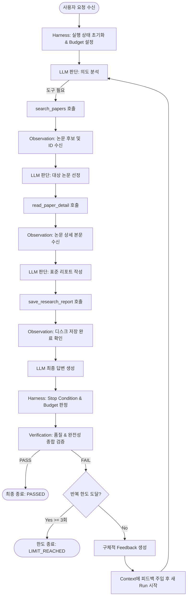

# 학술 논문 탐색 및 검증 기반 표준 기술 리포트 작성 Agent

이 프로젝트는 **Harness & Loop Engineering 기반 LLM Agent 세션**의 교육 원칙을 바탕으로 개발된 개인 과제 에이전트 시스템입니다.

LangChain의 `create_agent`와 3개의 정밀 도구(Tools)를 활용하여 AI 에이전트가 자율적으로 연구 논문을 탐색하고 정독하며, Agent 외벽의 **Harness**(실행 예산, 종료 조건, 예외 처리, 구조화된 Trace)와 **Outer Loop**(품질·완전성 중심 Verification, 피드백 주입, 재실행, Loop Limit)를 통해 신뢰성 높은 표준 기술 리포트를 자동 생성합니다.

---

## 1. Agent 목적 및 개요

- **목적**: 사용자의 관심 연구 주제에 맞춰 미리 구성된 학술 논문 코퍼스에서 관련 논문을 자율 탐색하고, 본문과 방법론을 정독한 후 정형화된 표준 서식의 기술 리포트를 작성하여 디스크에 영구 보관합니다.
- **핵심 특징**:
  - **자율적인 의사결정 Loop**: 파이프라인 형태의 하드코딩된 호출이 아닌, LLM(`gpt-4.1-mini`)이 관찰 결과(Observation)를 보고 다음 행동을 스스로 결정합니다.
  - **견고한 Outer Harness**: 모델의 무한 루프, API 타임아웃, 예외 발생을 감시하고 제어하는 외벽 계층을 분리 구현했습니다.
  - **품질/완전성 기반 Verification**: 도구 호출 횟수 자체에 의존하지 않고, 산출물의 실질적 정보 충실도와 서식 완전성, 실제 파일 저장 여부를 다각도로 검증합니다.
  - **피드백 기반 Re-run Outer Loop**: 검증 결함 발생 시 구체적인 수정 지침(Feedback)을 생성하여 다음 시도에 주입하며, 최대 재실행 횟수(3회)를 엄격히 제한합니다.

---

## 2. 사용 도구 (Tools) 상세 명세

베이스라인 스타일(LangChain `@tool`, 명확한 타입 힌트, 상세한 docstring)에 맞추어 3개의 로컬 도구를 구현했습니다. 불필요한 외부 의존성을 배제하고 학술 코퍼스(ReAct, Toolformer, Reflexion 등)의 원문 서지정보 및 방법론을 충실히 반영했습니다.

| 도구명 | 입력 인자 | 반환값 | 역할 및 Observation |
| :--- | :--- | :--- | :--- |
| `search_papers` | `query: str` | 일치하는 논문 목록 문자열 (ID, 제목, 저자, 발표연도, 초록) | 관심 키워드로 논문 코퍼스를 탐색하여 후보 논문의 메타데이터와 고유 `paper_id`를 반환합니다. |
| `read_paper_detail` | `paper_id: str` | 논문 상세 본문, 핵심 방법론, 한계점 전문 | 선택한 `paper_id`의 심층 연구 내용과 방법론을 조회하여 리포트 작성의 근거 자료를 제공합니다. |
| `save_research_report` | `paper_id: str`, `content: str` | 파일 저장 결과 메시지 (파일명, 저장 바이트 수) | 표준 서식으로 작성된 리포트 전문을 디스크의 `report_{paper_id}.md` 파일로 실제 기록합니다. |

---

## 3. Agent 실행 흐름 (Agent Flow)

Agent는 정해진 순서대로 강제 실행되는 것이 아니라, LangChain `create_agent` 내부에서 모델이 환경의 Observation을 반영하여 스스로 다음 행동을 판단합니다.



---

## 4. Harness 엔지니어링 구현 내용

실습 2의 패턴을 계승하여 Agent의 실행 안정성과 제어 가능성을 보장하는 Outer Harness를 구현했습니다.

1. **Stop Condition**:
   - 에이전트가 추가 Tool 호출 없이 최종 답변을 도출했을 때 정상 종료(`COMPLETED`).
   - 실행 예산 소진 시 강제 중단(`STOPPED`).
   - 모델 타임아웃 또는 복구 불가능한 예외 발생 시 안전 중단(`TIMEOUT`, `ERROR`).
2. **Execution Budget**:
   - `MAX_STEPS_DEFAULT = 8`: 한 Run 내에서 허용되는 최대 모델 호출 스텝을 제한.
   - `budget_exhausted(state, max_steps)` 함수로 매 단계마다 예산 소진 여부 점검.
   - LangChain 호출 시 `recursion_limit`을 설정하여 내부 무한 순환을 차단.
3. **Error Handling**:
   - `ChatOpenAI(max_retries=0)`으로 설정하여 내부 자동 재시도를 끄고, 외벽 Harness가 `APITimeoutError`, `APIError`, `ValueError` 등을 직접 포착.
   - `is_timeout_error()` 판정 함수를 통해 네트워크 지연 오류와 일반 예외를 명확히 구분하여 처리.
4. **구조화된 Trace**:
   - `RunState` 내에 실행 전 과정을 이벤트 단위로 보관:
     - `AGENT_START`: 요청 수신 및 실행 시작
     - `MODEL_STEP`: 모델 호출 스텝 번호
     - `TOOL_CALL`: 모델의 도구 호출 의도 및 인자
     - `TOOL_RESULT`: 실제 도구 실행 결과 및 성공 여부
     - `FINAL_ANSWER`: 최종 응답 글자 수
     - `RUN_END` / `RUN_STOPPED`: 실행 종료 상태
     - `VERIFICATION`: 검증 판정 결과
     - `FEEDBACK`: 생성된 피드백 미리보기
     - `RERUN`: 다음 반복 회차 정보

---

## 5. Verification & Re-run Loop 구현 내용

단순히 "도구를 호출했는가"를 확인하는 것에 그치지 않고, **최종 결과물의 품질과 완전성**을 중심으로 검증을 수행합니다.

### 1) Verification 3대 검증 기준
1. **논문 정보의 충분성 (`verify_paper_info_completeness`)**:
   - 제목이 `# [리포트] {논문 제목}` 형식으로 명시되었는가?
   - 필수 메타데이터(`저자`, `발표연도`)가 빠짐없이 포함되었는가?
   - 본문 분량이 충분(최소 200자 이상)하여 단순 요약이 아닌 심층 분석을 담고 있는가?
2. **필수 섹션 및 서식 완전성 (`verify_required_sections`)**:
   - 기술 리포트 필수 섹션 3개가 헤더로 온전히 존재하는가?
     - `## 1. 핵심 요약`
     - `## 2. 주요 연구 내용 및 의의`
     - `## 3. 한계 및 시사점`
   - 양식의 중괄호(`{`, `}`)나 불완전한 플레이스홀더 잔존 여부 점검.
3. **저장 산출물 무결성 (`verify_saved_file_integrity`)**:
   - 디스크 상에 `report_{paper_id}.md` 파일이 실제 존재하는가?
   - 파일 내용이 비어있지 않고 온전히 저장(최소 100자 이상)되었는가?

### 2) Feedback 생성 및 Re-run 메커니즘
- 검증에 실패한 경우, `make_feedback()` 함수가 발견된 문제점들을 bullet-point 형태의 구체적 개선 요구사항으로 변환합니다.
- 다음 반복 실행 시 동일한 요청을 단순 재호출하지 않고, 이전 시도의 작성본과 피드백을 Context에 함께 주입하여 모델이 스스로 결함을 교정하도록 합니다.
- **Loop Limit**: 최대 반복 횟수를 **3회**(`MAX_ITERATIONS_DEFAULT = 3`)로 제한하여, 수렴하지 않는 실패 상황에서도 무한 실행을 방지합니다 (`route_loop` -> `LIMIT_REACHED`).

---

## 6. 실행 환경 및 실행 방법

### 1) 사전 준비
- Python 3.12 가상환경 활성화 (프로젝트 기본 환경 `5-week3`)
- 프로젝트 루트의 `.env` 파일에 OpenAI API 키 설정:
  ```env
  OPENAI_API_KEY=your-actual-openai-api-key
  OPENAI_MODEL=gpt-4.1-mini
  ```

### 2) 실행 명령어
프로젝트 루트 디렉토리에서 다음 명령을 실행합니다:
```powershell
python assignment/jeongin/agent.py
```

---

## 7. 실제 실행 결과 예시 (Live Execution Log)

다음은 실제 `gpt-4.1-mini` 모델과 로컬 도구들을 연동하여 실행한 실제 터미널 출력 기록입니다.

```text
=== [과제] 학술 논문 탐색 및 검증 기반 기술 리포트 작성 Agent 실행 ===

================================================================================
[OUTER LOOP START] 최대 반복 한도: 3회
================================================================================

>>> [LOOP ITERATION 1 / 3]

[HARNESS START] Task: AI Agent의 도구 사용 또는 행동-추론 결합에 관한 대표 논문을 하나 검색해서 본문을 읽고, 정해진 서식에 맞춘 기술 리포트를 작성하여 파일로 저장해줘....
  [TOOL CALL] search_papers({'query': 'AI Agent tool use and action-reasoning'})
  [TOOL RESULT] search_papers: 총 3건의 논문이 검색되었습니다:

[논문 ID: paper_001]
- 제목: ReAct: Synergizing Reasoning and Acting in Language Models
- 저자: Shunyu Yao, Jeffrey Zhao, Dian Yu, Nan Du, Izhak Shafran, Karthik Narasimhan, Yuan Cao...
  [TOOL CALL] read_paper_detail({'paper_id': 'paper_001'})
  [TOOL RESULT] read_paper_detail: === 논문 상세 정보: paper_001 ===
제목: ReAct: Synergizing Reasoning and Acting in Language Models
저자: Shunyu Yao, Jeffrey Zhao, Dian Yu, Nan Du, Izhak Shafran, Karthik Narasimhan, Yuan Cao...
  [TOOL CALL] save_research_report({'paper_id': 'paper_001', 'content': '# [리포트] ReAct: Synergizing Reasoning and Acting in Language Models\n- 저자: Shunyu Yao, Jeffrey Zhao, Dian Yu, Nan Du, Izhak Shafran, Karthik Narasimhan, Yuan Cao\n- 발표연도: 2022\n- 출처: ICLR 2023, arXiv:2210.03629\n\n## 1. 핵심 요약\nReAct는 대규모 언어 모델에서 추론(Chain-of-Thought)과 행동(Action 실행 및 환경 피드백 관찰)을 번갈아 수행하도록 설계된 혁신적인 프레임워크이다...\n\n## 2. 주요 연구 내용 및 의의\n...\n\n## 3. 한계 및 시사점\n...'})
  [TOOL RESULT] save_research_report: 리포트 파일 저장 성공: report_paper_001.md (총 1062자 저장 완료)...
[HARNESS END] Status: COMPLETED, Steps: 4, ToolCalls: 3

[VERIFICATION RESULT]
  Status: PASS (모든 품질 및 완전성 기준 충족!)

[LOOP SUCCESS] 1회차 실행에서 검증을 최종 통과했습니다.

================================================================================
[OUTER LOOP FINISHED] 최종 상태: PASSED, 총 Run 횟수: 1
================================================================================

=================== [마지막 Run Trace] ===================
status=COMPLETED, steps=4, tool_calls=3
  01. AGENT_START: {'task_preview': 'AI Agent의 도구 사용 또는 행동-추론 결합에 관한 대표 논문을 하나 검색해서 본문을 읽고...'}
  02. MODEL_STEP: step=1
  03. TOOL_CALL: {'name': 'search_papers', 'args': {'query': 'AI Agent tool use and action-reasoning'}}
  04. TOOL_RESULT: {'name': 'search_papers', 'output': '총 3건의 논문이 검색되었습니다:\n\n[논문 ID: paper_001]...', 'status': 'SUCCESS'}
  05. MODEL_STEP: step=2
  06. TOOL_CALL: {'name': 'read_paper_detail', 'args': {'paper_id': 'paper_001'}}
  07. TOOL_RESULT: {'name': 'read_paper_detail', 'output': '=== 논문 상세 정보: paper_001 ===\n제목: ReAct...', 'status': 'SUCCESS'}
  08. MODEL_STEP: step=3
  09. TOOL_CALL: {'name': 'save_research_report', 'args': {'paper_id': 'paper_001', 'content': '# [리포트] ReAct...'}}
  10. TOOL_RESULT: {'name': 'save_research_report', 'output': '리포트 파일 저장 성공: report_paper_001.md (총 1062자 저장 완료)', 'status': 'SUCCESS'}
  11. MODEL_STEP: step=4
  12. FINAL_ANSWER: length=1062
  13. RUN_END: 정상 종료
  14. VERIFICATION: {'passed': True, 'issues_count': 0}
  15. LOOP_END: PASSED
============================================================
```

### 생성된 실제 산출물 (`assignment/jeongin/report_paper_001.md`)
```markdown
# [리포트] ReAct: Synergizing Reasoning and Acting in Language Models
- 저자: Shunyu Yao, Jeffrey Zhao, Dian Yu, Nan Du, Izhak Shafran, Karthik Narasimhan, Yuan Cao
- 발표연도: 2022
- 출처: ICLR 2023, arXiv:2210.03629

## 1. 핵심 요약
ReAct는 대규모 언어 모델에서 추론(Chain-of-Thought)과 행동(Action 실행 및 환경 피드백 관찰)을 번갈아 수행하도록 설계된 혁신적인 프레임워크이다. 기존 추론이나 행동 단독 모델의 한계를 극복하기 위해, 모델이 사고(Thought), 행동(Action), 관찰(Observation)을 순환하며 외부 도구와 상호작용하도록 하여 문제 해결 능력과 해석 가능성을 크게 향상시켰다.

## 2. 주요 연구 내용 및 의의
ReAct는 순수 추론 모델이 갖는 내부 파라미터 지식만 의존하는 한계와 환각 문제, 그리고 순수 행동 모델이 복잡한 추론 및 장기 계획 수립이 불가능한 문제를 동시에 해결하고자 고안되었다. 이 방법론은 모델이 반복적으로 사고를 하고, 행동을 실행하며, 그 결과를 관찰해서 다음 행동에 반영하는 순환 루프를 형성한다. 이러한 상호작용은 HotpotQA와 Fever 벤치마크에서 환각 문제를 현저히 줄이고 문제 해결 정확도와 해석 가능성을 크게 향상시키는 결과로 입증되었다. 이로써 ReAct는 AI 에이전트가 실세계와 유사한 복잡한 환경에서 효과적으로 대처하는 데 중요한 전략으로 자리잡았다.

## 3. 한계 및 시사점
ReAct 프레임워크는 외부 도구를 빈번히 호출하는 구조로 인해 실행 지연 시간과 토큰 사용량이 증가하는 단점이 있으며, 다단계의 복잡한 환경에서는 에러가 누적되어 성능 저하 위험이 존재한다. 이 점을 해결하기 위해서는 효율적인 액션 계획 및 오류 조정 메커니즘, 그리고 도구 사용 최적화 연구가 요구된다. 또한, ReAct의 개념은 추론과 행동의 결합이 필요한 다양한 AI 응용 분야에 확장 가능성이 높아 차후 연구가 활발히 이루어질 전망이다.
```
